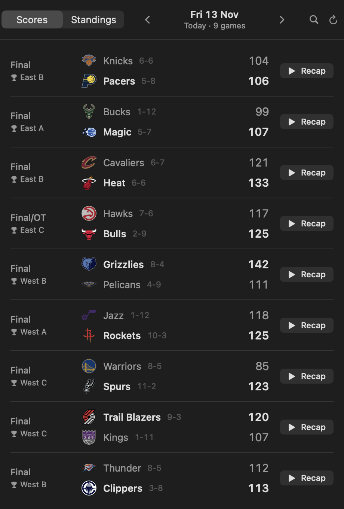
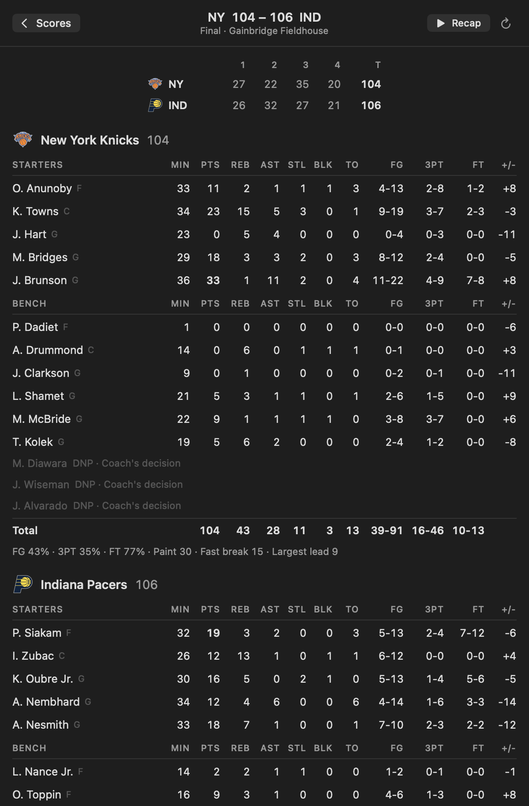
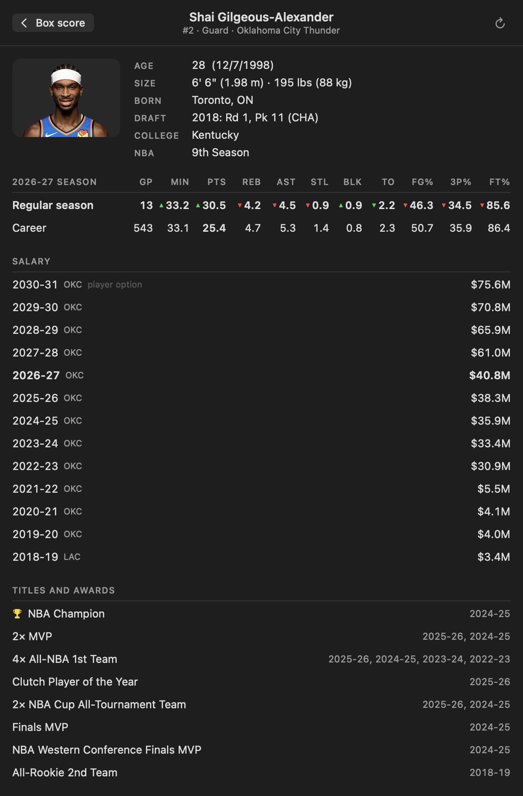
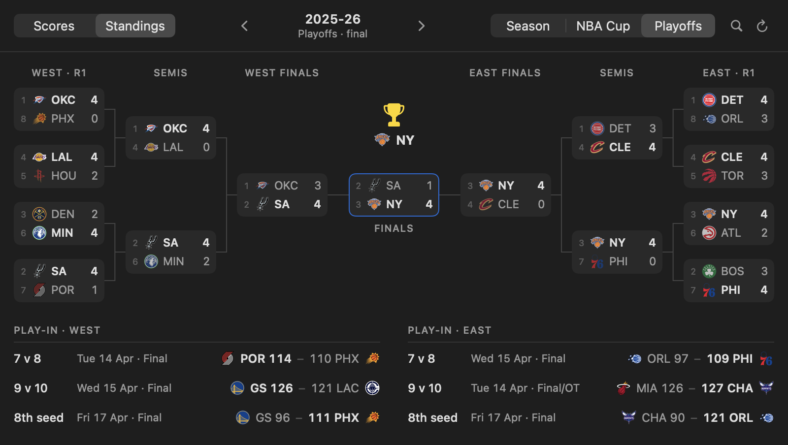
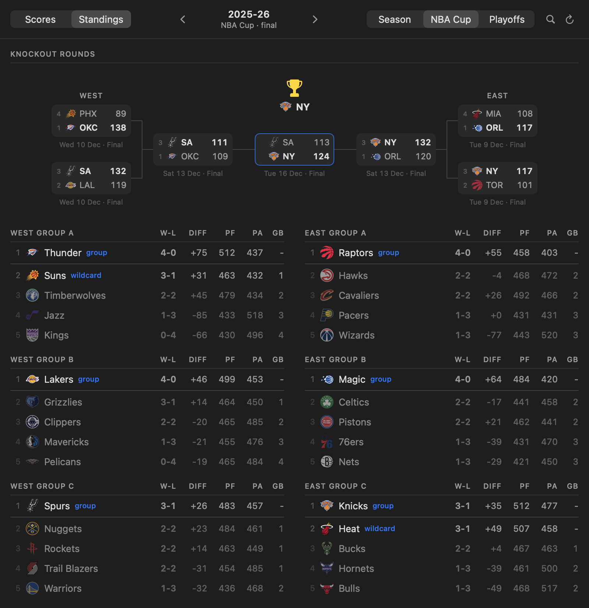
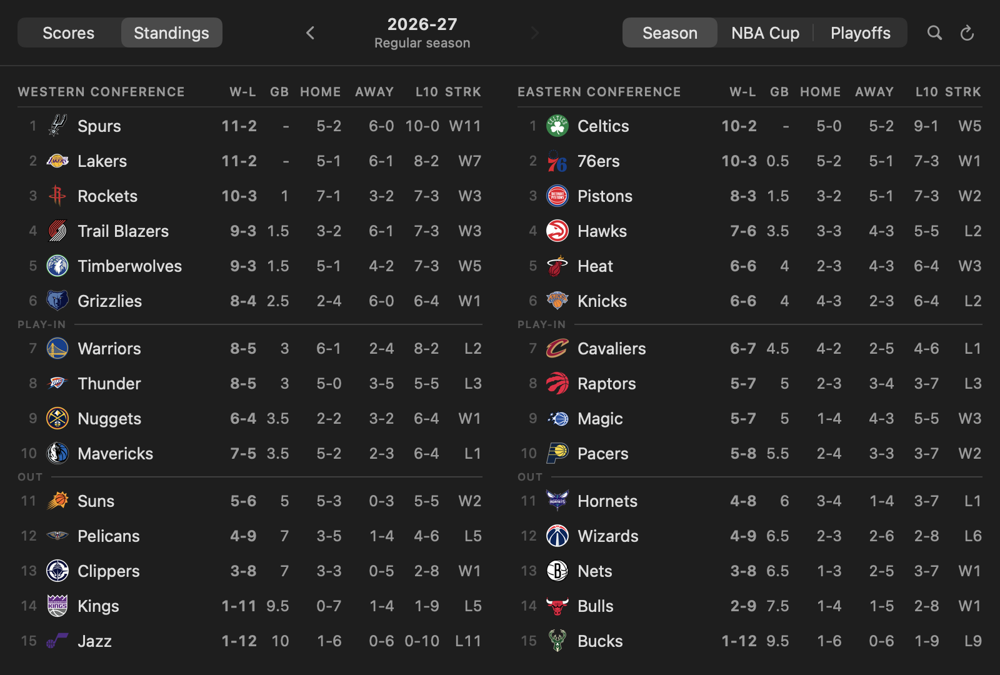
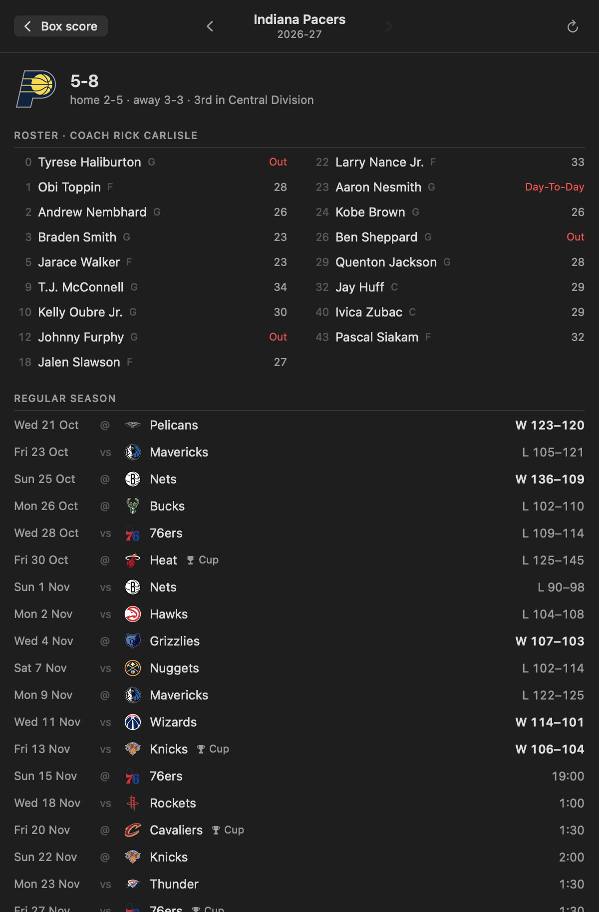
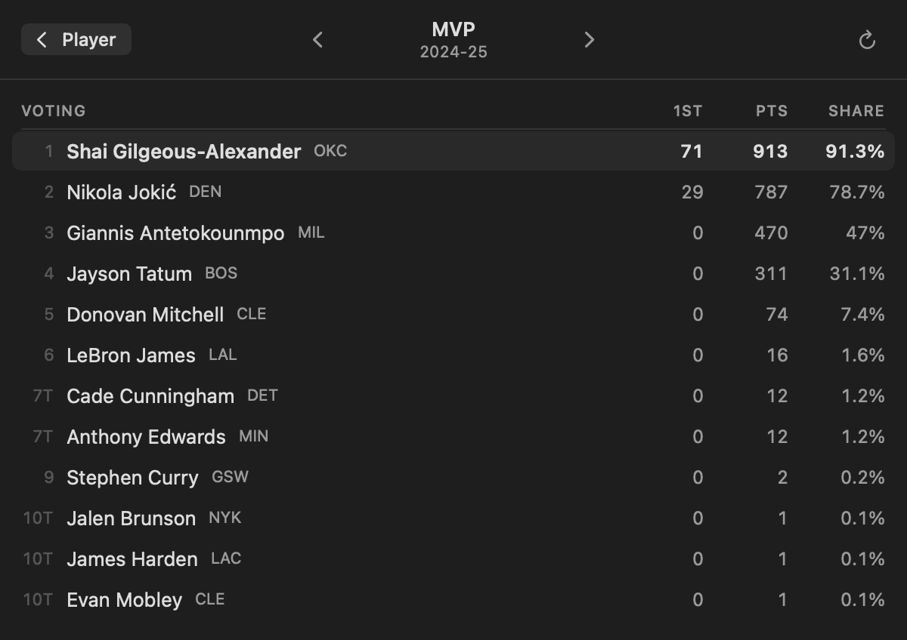

# NBA Scores for macOS

[](LICENSE)

NBA Scores is a menu bar app for macOS. A basketball sits in the menu bar, with the number of games that are live right now. A click opens a panel with the games of the day, and you can step through the whole season day by day. Every game opens its full box score, every player opens his card (bio, salary, titles, awards, career), every team opens its page (roster and season), and every finished game has a **Recap** button to its recap video on NBA.com. A search finds any player or team, retired players and old franchise names included. The panel also has the regular-season standings, the NBA Cup and the playoffs, each with its bracket, for this season and the ones before.

It is a native port of [omarchy-nba-scores](https://github.com/Onra/omarchy-nba-scores), the same widget for the Omarchy shell. The data comes from ESPN's public API, which does not need an API key.

| Scores of the day | Box score | Player card |
| :---: | :---: | :---: |
|  |  |  |

| Playoffs | NBA Cup |
| :---: | :---: |
|  |  |

| Standings | Team page | Award voting |
| :---: | :---: | :---: |
|  |  |  |

## Features

**Scores**
- The menu bar shows a basketball, plus `● 3` in the accent colour while three games are live
- Every game of the day: tip-off time in your timezone, TV network, records, the score, and the betting line before tip-off
- NBA Cup games are tagged with their group or round (`East A`, `QF`), playoff games with the state of their series
- Step through every game day of the season. A day is a US Eastern date, as for the NBA: a game that tips off at 01:30 in Paris belongs to the day before
- Live games refresh every 30 seconds, and everything else every 5 minutes

**Box score and player card**
- The score by quarter, then every player: minutes, points, rebounds, assists, steals, blocks, turnovers, shooting and plus-minus. Starters and bench apart, the top scorer in bold, the reason a player did not play
- A click on a player opens his card: photo, age, size (in feet and pounds, and in metres and kilos), birthplace, draft, college, injury, his averages this season, in the playoffs and over his career (a green or red arrow by each of this season's averages says whether it beats his career's), his titles (NBA championships and NBA Cups won with his team) and awards, his career season by season, and his salary season by season, including the seasons to come with player and team options
- An injured player's card says when he is expected back, beside the injury (`Out · Hamstring (est. Sun 22 Nov)`), and so does his line on his team's roster (`Out · 22 Nov`). The date is ESPN's estimate
- A retired player's card says **Retired**, and a free agent's says **Free agent**, in place of the team
- A title on a card opens the bracket of that season: the playoffs for an NBA title (from 2007-08), the NBA Cup for a Cup. Back returns to the card
- An award on a card opens its voting for that season: rank, team, first-place votes, points and share of the vote, with the player marked. For All-NBA, All-Defensive and All-Rookie, the players are listed by team (1st, 2nd, 3rd), then the other players who got votes. The chevrons step through the seasons, back to the first voting Basketball-Reference has (1955-56 for the MVP). Finals, All-Star and Cup MVPs have no voting, so they do not open

**Search and team pages**
- `/`, `⌘F` or the magnifying glass searches every NBA player and team, past and present: Bill Russell, Michael Jordan, the Lakers. The old names of today's franchises lead to the team they became: `Sonics` finds the Thunder, `Bobcats` the Hornets, `New Jersey Nets` the Nets
- A team's page: its record (overall, home and away), its place in the standings, the coach, the roster with ages and injuries, and every game of the season (regular season, play-in and playoffs) with its result. NBA Cup games are marked with their round, and the Cup final is left out of the record, as in the standings
- The chevrons on a team page step through its seasons back to 1992-93, the first one ESPN has whole. Past seasons show the games only: ESPN has no past rosters
- Team logos and names link to their page everywhere: in the scores, the box score, the standings, and on a player card, where each season of his career opens that team's page for that season

**Recap**
- A **Recap** button on each finished game, in the scores and in the box score (`y` too), opens the game's recap video on NBA.com in your browser

**Standings, NBA Cup and playoffs**, for the current season and the ones before
- The regular-season standings, West and East side by side, with the playoff and play-in lines (from 2002-03)
- The NBA Cup: the group tables with the official tiebreakers, the wildcard race, and the knockout tree, projected from the groups until the quarterfinals are set (from the 2023-24 In-Season Tournament)
- The playoffs: a bracket of series with the West on the left and the East on the right, the champion under the trophy, and the play-in. Before the playoffs the bracket is projected from the standings. A click on a series lists its games (from 2007-08)

**And**
- Keyboard control, and `⌥⌘B` to open the panel from anywhere
- Light and dark mode, system colours and fonts
- Starts at login; the right-click menu turns that off
- No API key, and no account

## Requirements

macOS 26 and Xcode 26 or later (for the Swift toolchain).

## Installation

```sh
git clone https://github.com/Onra/macos-nba-scores
cd macos-nba-scores/app
./build.sh install
```

This builds `NBA Scores.app`, copies it to `/Applications` and launches it. The app is signed ad hoc, for your own Mac. Run the same command again to update it.

## Usage

Click the basketball to open the panel, or press `⌥⌘B`. Right-click the basketball for Refresh, Launch at Login and Quit.

| Key | Action |
| --- | --- |
| `←` `→` | Previous or next game day; in a box score, previous or next game; in the standings, on a team page and in a voting, previous or next season |
| `↑` `↓` | Move through the games, or the search results |
| `Enter` | Open the box score of the selected game, or the selected search result |
| `Esc` | Back, or close the panel |
| `/` or `⌘F` | Search teams and players |
| `y` | Open the recap of the selected game or of the open box score |
| `r` | Refresh |
| `t` | Back to today |
| `b` | Scores |
| `s` | Standings |
| `p` | Next table: regular season, NBA Cup, playoffs |
| `c` | NBA Cup |
| `o` | Playoffs |

Opening the panel always returns to today's scores.

## How it works

The app is pure Swift: SwiftUI for the panel (`app/Sources/NBAScores`), and a small library with no UI for the data (`app/Sources/NBAKit`).

| What | Where from |
| --- | --- |
| Scores, box scores, standings, team pages, player bio and stats, search | ESPN's public API |
| Salary of each season under contract | ESPN |
| Salaries of the seasons to come, with options | Basketball-Reference, one page for every player, fetched at most once a day |
| Injuries and estimated return dates | ESPN |
| NBA champions, for the titles on a card | Basketball-Reference, one page, kept for a week |
| Award voting | Basketball-Reference, one page per season, kept for good |
| NBA Cup results and tables | ESPN's scoreboard of each day of the Cup, with the Cup tiebreakers applied |
| NBA Cup group names and clinch marks | NBA.com. When it does not answer, groups are found from the schedule and shown without a letter |
| Playoff bracket | ESPN's scoreboard of each day from April to June, and the standings for the seeds |

What does not change is cached under `~/Library/Caches/nba-bar`: a finished day of the Cup or the playoffs is never fetched again, nor is a past season of a team. The first time you open a past season's Cup or playoffs, the app fetches every day of it, which takes a few seconds.

## Development

```sh
cd app
swift test
swift run NBAScores --snapshot /tmp/nba-scores-shots
```

The tests run the parsing, the Cup tiebreakers and the brackets against saved answers of ESPN and Basketball-Reference. The second command fetches live data and renders every screen to PNG files, in light and dark, without opening anything: the screenshots above come from it.

## Troubleshooting

- **"Couldn't reach ESPN"**: check the connection, then press `r`. The app keeps showing what it had.
- **A card has no future salaries, or no titles**: Basketball-Reference did not answer, which happens when it is asked too often. The card is built again 6 hours later.
- **NBA Cup groups without a letter**: NBA.com did not answer. The tables are still right; the letters come back when it does.
- **Start over**: quit the app and delete `~/Library/Caches/nba-bar`.

## Disclaimer

This project is not affiliated with the NBA, ESPN, Basketball-Reference or Apple. Team names and logos belong to their owners. The data comes from public pages and APIs that may change or stop without notice.

## License

[MIT](LICENSE)
